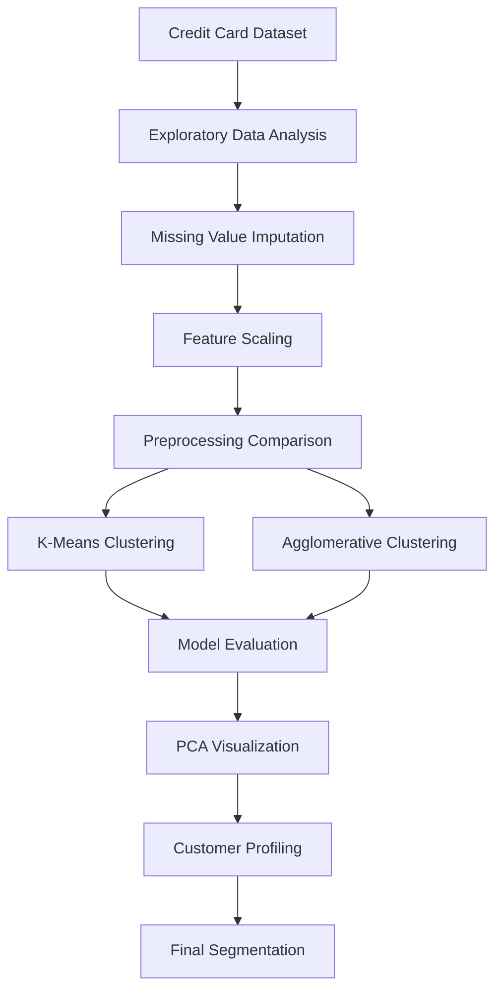
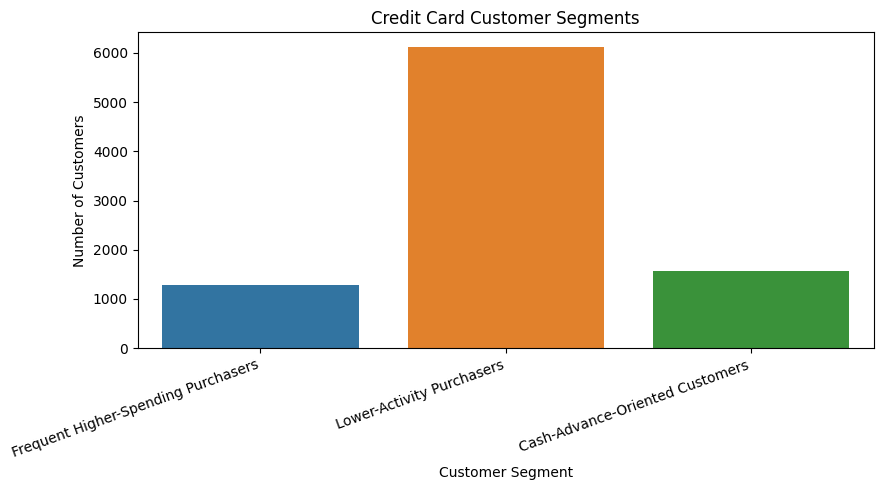
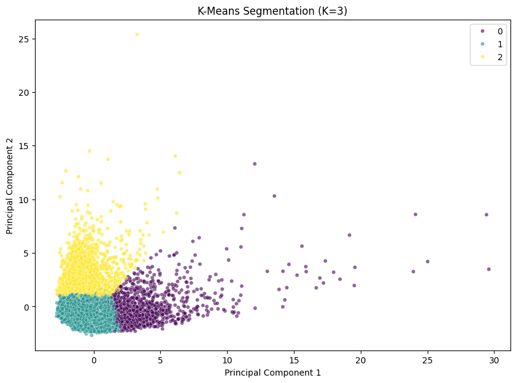

# 💳 Credit Card Customer Segmentation

<p align="center">
  <strong>Unsupervised Machine Learning | Customer Behavior Analytics</strong>
</p>

<p align="center">
  Discovering meaningful customer behavior patterns using machine learning.
</p>

<p align="center">
  
  
  
  
</p>

---

## 📌 Overview

How can a bank understand thousands of credit card customers with different spending and payment behaviors?

This project applies **unsupervised machine learning** to segment credit card customers according to their financial activity, including purchase amounts, transaction frequency, account balances, payment behavior, and cash advance usage.

Using exploratory data analysis, preprocessing, clustering algorithms, and dimensionality reduction, the project identifies three interpretable customer segments from 8,950 customer records.

## 📊 Project Highlights

| Metric | Result |
|---|---:|
| Customer records | 8,950 |
| Original dataset columns | 18 |
| Features used for clustering | 17 |
| Selected algorithm | K-Means |
| Selected cluster count | 3 |
| Silhouette score | 0.2403 |
| Davies–Bouldin index | 1.5920 |

> **Selected baseline:** K-Means with three clusters, chosen based on the tested silhouette scores, cluster sizes, and interpretability. The modest silhouette score indicates that separation between customer groups is limited.

## 🎯 Problem Statement

Credit card customers exhibit different spending and payment patterns. Identifying these behavioral groups can help financial institutions understand customer activity and investigate opportunities for more targeted customer engagement.

The project addresses the following questions:

- Can customers be grouped based on similar financial behavior?
- Which customers demonstrate frequent purchasing activity?
- Which customers rely more heavily on cash advances?
- How do K-Means and Agglomerative Clustering compare?
- How can clustering results be evaluated and visualized?

## 🛠️ Tech Stack

| Category | Technologies |
|---|---|
| Programming | Python |
| Data processing | Pandas, NumPy |
| Data visualization | Matplotlib, Seaborn |
| Machine learning | Scikit-learn |
| Dimensionality reduction | Principal Component Analysis (PCA) |
| Development environment | Google Colab |

## 🔄 Project Workflow



## 🔍 Methodology

### 1. Exploratory Data Analysis

- Inspected dataset dimensions, data types, missing values, and duplicate records.
- Examined distributions of financial features.
- Visualized feature correlations.
- Investigated skewness and potential outliers.

### 2. Data Preprocessing

- Removed `CUST_ID` from the model inputs.
- Imputed missing numerical values using median imputation.
- Applied `StandardScaler` to standardize feature scales.
- Compared standard scaling against `log1p` transformation followed by standard scaling.

### 3. Algorithm Comparison

Evaluated K-Means for cluster counts from 2 to 8 and compared selected configurations with Agglomerative Clustering using Ward linkage.

### 4. Model Evaluation

The following metrics were used:

- **Silhouette Score:** Measures how well observations fit within their assigned clusters compared with neighboring clusters. Higher values are generally better.
- **Davies–Bouldin Index:** Measures similarity between clusters. Lower values are generally better.
- **Adjusted Rand Index (ARI):** Measures agreement between cluster assignments across different model initializations.

### 5. PCA Visualization

Principal Component Analysis was used to project the 17 standardized features into two dimensions for visualization.

PCA was used to visualize the K-Means assignments, not to generate the original cluster labels.

## 🤖 Model Evaluation

### K-Means vs. Agglomerative Clustering

| Algorithm | K | Silhouette ↑ | Davies–Bouldin ↓ | Smallest cluster |
|---|---:|---:|---:|---:|
| **K-Means** | **3** | **0.2403** | 1.5920 | 1,275 |
| Agglomerative | 3 | 0.1548 | 1.8496 | 1,194 |
| K-Means | 8 | 0.2252 | **1.3697** | 25 |
| Agglomerative | 8 | 0.1614 | 1.3882 | 23 |

### Why K-Means with K = 3?

- Achieved the highest silhouette score among the four tested configurations.
- Produced three customer segments with interpretable median profiles.
- Avoided the very small clusters observed in the eight-cluster solutions.
- Demonstrated high agreement across the tested random initializations, with ARI values between 0.9723 and 1.0000.

Although K-Means with eight clusters achieved a lower Davies–Bouldin index, its smallest cluster contained only 25 customers. The three-cluster solution provides a simpler baseline for interpretation.

**Model limitation:** A silhouette score of 0.2403 indicates limited cluster separation. The selected model is an exploratory segmentation solution, not a definitive classification or prediction system.

## 👥 Customer Segmentation Results

The selected K-Means model identified three behavioral segments.

| Cluster | Customer Segment | Customers | Percentage |
|---|---|---:|---:|
| 0 | Frequent Higher-Spending Purchasers | 1,275 | 14.25% |
| 1 | Lower-Activity Purchasers | 6,114 | 68.31% |
| 2 | Cash-Advance-Oriented Customers | 1,561 | 17.44% |
| **Total** | **All customers** | **8,950** | **100%** |

### 🛍️ Cluster 0 — Frequent Higher-Spending Purchasers

- Median purchases: 3,055.87
- Median purchase transactions: 44
- Median purchase frequency: 1.00
- Median cash advance: 0

**Insight:** This segment demonstrates relatively high purchase activity and higher median spending than the other segments.

### 👤 Cluster 1 — Lower-Activity Purchasers

- Median purchases: 299.95
- Median purchase transactions: 6
- Median purchase frequency: 0.42
- Median balance: 432.97

**Insight:** This is the largest segment, characterized by lower median purchase amounts and fewer purchase transactions.

### 💵 Cluster 2 — Cash-Advance-Oriented Customers

- Median cash advance: 3,135.11
- Median purchases: 0
- Median purchase transactions: 0
- Median balance: 3,508.56

**Insight:** This segment exhibits higher median cash advance usage alongside little or no purchasing activity.

*Segment labels describe observed behavior and should not be interpreted as creditworthiness, profitability, or default-risk ratings.*

## 📈 Visualizations

### Customer Segment Distribution

<p align="center">
  
</p>

<p align="center">
  <em>The lower-activity segment represents 68.31% of the dataset.</em>
</p>

### PCA Cluster Visualization

<p align="center">
  
</p>

<p align="center">
  <em>Two-dimensional projection of the K-Means clusters. Some overlap is expected because the original model uses 17 features.</em>
</p>

## 💡 Key Findings

- The majority of customers belong to the lower-activity segment.
- Frequent higher-spending purchasers form a distinct behavioral group.
- A separate segment shows substantial cash advance usage with little or no purchasing activity.
- StandardScaler achieved a higher silhouette score than the tested log-transformed alternative.
- K-Means outperformed Agglomerative Clustering on silhouette score at both tested cluster counts.
- Different evaluation metrics can favor different cluster counts, so model selection requires considering both quantitative scores and business interpretability.

## 🚀 Future Improvements

- Investigate feature selection and reduce redundant feature contributions.
- Compare alternative transformations and robust scaling techniques.
- Evaluate DBSCAN and additional clustering approaches.
- Test stability across different data samples and preprocessing pipelines.
- Build an interactive dashboard for exploring customer segments.
- Conduct further validation before using the segments to support business decisions.

## ⚙️ How to Run

1. Clone or download this repository.
2. Open `credit_card_customer_segmentation.ipynb` in Google Colab.
3. Upload the `CC GENERAL.csv` dataset when prompted.
4. Execute the notebook cells in order.
5. Review the data analysis, preprocessing, model evaluation, visualizations, and customer profiles.

### Dependencies

The main libraries used are:

```text
pandas
numpy
matplotlib
seaborn
scikit-learn
```

## 📁 Repository Structure

```text
credit-card-customer-segmentation/
│
├── README.md
├── credit_card_customer_segmentation.ipynb
├── requirements.txt
└── images/
    ├── customer_segmentation.png
    └── pca_clusters.png
```

The raw dataset and customer-level exports are not required in the public repository. Confirm dataset redistribution terms before sharing the original data.

## ⚠️ Limitations

- The dataset does not contain ground-truth customer segment labels.
- The silhouette score indicates limited separation between clusters.
- Results depend on preprocessing, feature selection, and the clustering algorithm.
- PCA is a projection and may not preserve all structure in the original feature space.
- The clusters do not predict credit default, financial risk, or customer profitability.

## 👨‍💻 Author

**Vishal J**

B.Tech (Hons.) — Artificial Intelligence and Data Science

- [GitHub](https://github.com/vxhll)
- [LinkedIn](https://www.linkedin.com/in/vishal-j-btech)

---

<p align="center">
  <strong>Built with Python and Scikit-learn</strong><br/>
  <em>Turning customer data into interpretable behavioral insights.</em>
</p>
